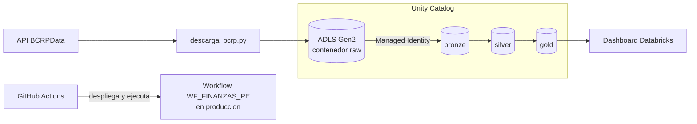
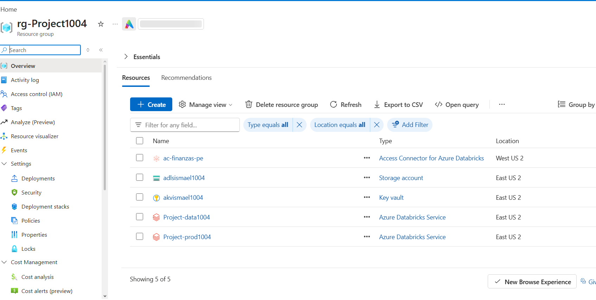
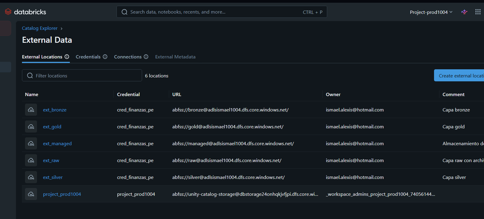
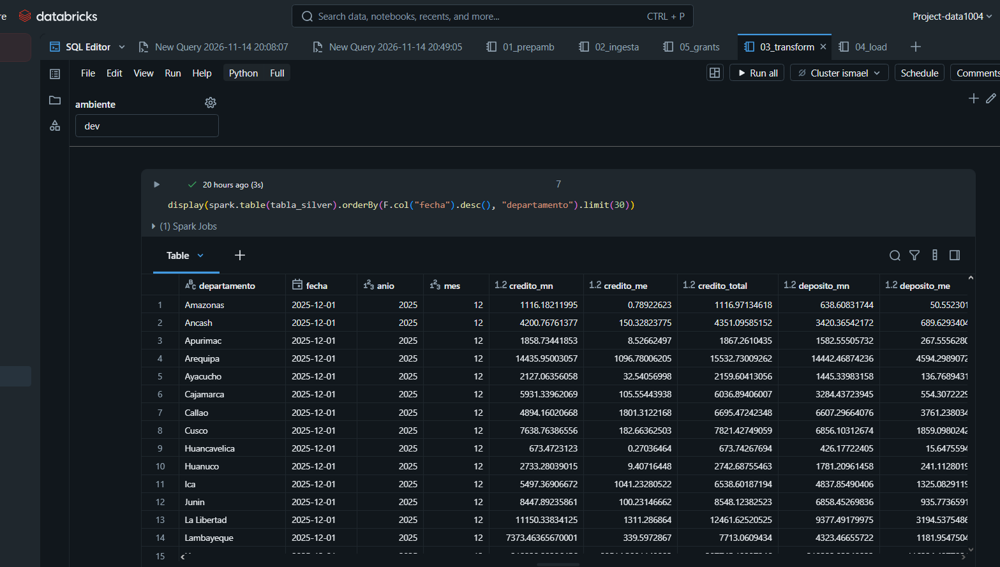
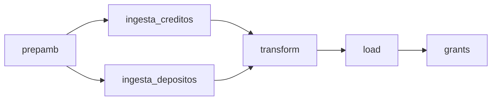
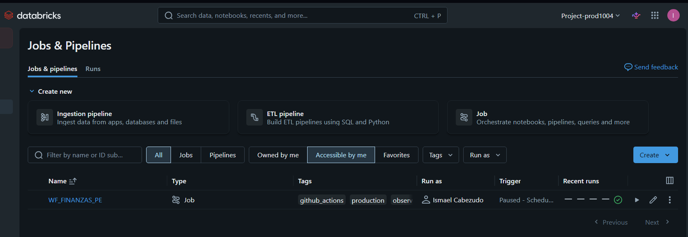
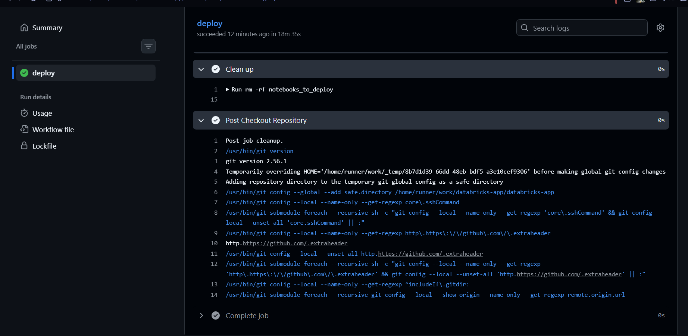
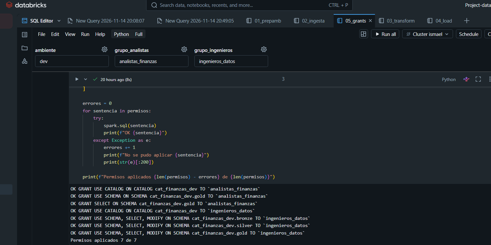

# Observatorio de créditos y depósitos del sistema financiero peruano

Proyecto final del curso Ingeniería de Datos con Databricks.

En este proyecto armé un ETL en Azure Databricks que toma las series oficiales del BCRP sobre créditos y depósitos del sistema financiero por departamento, las procesa con arquitectura medallion y las deja listas para un dashboard. La idea es responder preguntas simples pero útiles para alguien que planifica en una entidad financiera, por ejemplo qué departamentos concentran el crédito, cuáles crecen más, dónde se presta más de lo que se capta y cómo ha bajado la dolarización en los últimos años.

## Arquitectura

Los servicios que usé son estos

| Servicio | Nombre | Para qué lo usé |
|---|---|---|
| Azure Data Lake Storage Gen2 | adlsismael1004 | Capa raw y almacenamiento de bronze silver y gold |
| Access Connector for Azure Databricks | ac-finanzas-pe | Identidad administrada para entrar al Data Lake sin llaves |
| Azure Databricks desarrollo | Project-data1004 | Desarrollo y pruebas de los notebooks |
| Azure Databricks producción | Project-prod1004 | Ejecución del workflow y dashboard |
| Azure Key Vault | akvismael1004 | Lugar reservado para secretos, el acceso al Data Lake no lo necesita porque usa Managed Identity |
| Unity Catalog | cat_finanzas_dev y cat_finanzas_prod | Gobierno de datos, permisos y linaje |
| GitHub Actions | deploy-notebook.yml | CI/CD de desarrollo a producción |

## Datos de origen

Usé dos datasets públicos del BCRP, que a su vez vienen de la SBS. Los dos están en millones de soles y son saldos a fin de mes, desde enero 2015 hasta diciembre 2025.

| Dataset | Series | Filas | Ruta en raw |
|---|---|---|---|
| Crédito directo del sistema financiero al sector privado por departamento | RD13560DM a RD13637DM | 10296 | raw/bcrp/creditos |
| Depósitos en el sistema financiero por departamento | RD13638DM a RD13715DM | 10296 | raw/bcrp/depositos |

Cada dataset trae 25 departamentos más el total nacional, en moneda nacional, moneda extranjera y total. La descarga se hace con el script `datasets/descarga_bcrp.py`, que consulta la API de BCRPData y deja los dos CSV listos para subir al contenedor raw.

## Conexión segura al Data Lake

La capa raw no está en DBFS ni en un Volume, está en un contenedor de ADLS Gen2. Para conectarme usé solo Managed Identity siguiendo esta cadena

`ac-finanzas-pe` con rol Storage Blob Data Contributor sobre el storage → credencial `cred_finanzas_pe` en Unity Catalog → External Locations `ext_raw`, `ext_bronze`, `ext_silver`, `ext_gold` y `ext_managed`

Así ningún notebook tiene account keys ni SAS escritos. El script está en `PrepAmb/01_external_locations.sql`.

## Modelo de datos

| Capa | Tabla | Grano | Contenido |
|---|---|---|---|
| Bronze | creditos_departamento | serie y mes | El CSV tal como llega, en texto, más archivo de origen y fecha de ingesta |
| Bronze | depositos_departamento | serie y mes | Igual que la anterior para depósitos |
| Silver | saldos_departamento_mensual | departamento y mes | Datos limpios con monedas en columnas, créditos y depósitos unidos y marcas de calidad |
| Gold | indicadores_departamento_mensual | departamento y mes | Ratio crédito sobre depósito, dolarización, variación a 12 meses, participación nacional y ranking |
| Gold | resumen_anual_departamento | departamento y año | Saldo al cierre de cada año, crecimiento anual, dolarización promedio y ranking |

Todas las tablas son Delta, se crean vacías en la preparación de ambiente y el ETL solo inserta los datos. Cada ambiente tiene su propio catálogo y su propia carpeta física, por ejemplo `bronze/dev/...` y `bronze/prod/...`.

## Proceso ETL

Todos los notebooks están en la carpeta `proceso` y reciben el ambiente como parámetro, así el mismo código corre en desarrollo y en producción.

**01_prepamb** crea el catálogo del ambiente, los esquemas bronze silver y gold y las cinco tablas con su esquema definido. Se puede ejecutar varias veces sin borrar nada porque todo usa IF NOT EXISTS.

**02_ingesta** lee el CSV desde raw con un esquema StructType definido a mano, agrega columnas de auditoría con el archivo de origen y la fecha de ingesta y carga la tabla bronze. Es un solo notebook que recibe el parámetro dataset, por eso en el workflow aparece dos veces y las dos ingestas corren en paralelo.

**03_transform** hace la limpieza y la unión en silver. Quita duplicados, convierte el periodo de texto como Ene.2015 en una fecha real, castea los valores a número, descarta registros inválidos, pasa las monedas de filas a columnas con pivot y une créditos con depósitos por departamento y mes. La carga se hace con MERGE para poder reprocesar sin duplicar.

**04_load** calcula los indicadores de gold con funciones de ventana. Usa lag para la variación a 12 meses y el crecimiento anual, sum sobre el mes para la participación nacional, dense_rank para el ranking y row_number para quedarse con el saldo de cierre de cada año. Como los datos son saldos de fin de mes, el resumen anual toma el último mes y no suma los doce, porque sumarlos contaría el mismo saldo varias veces.

**05_grants** aplica los permisos al final del proceso.

Todo el ETL usa la API de DataFrames de PySpark, sin spark.sql para transformar. SQL solo aparece en la preparación de ambiente, los permisos y la reversión.

### Regla de calidad de datos

Al revisar los datos encontré que en créditos de julio 2021 el total reportado no coincide con la suma de moneda nacional y moneda extranjera en 23 departamentos, en Puno la diferencia llega a 26 %. En depósitos todo cuadra. Como el problema viene de la fuente, en silver agregué una regla que compara las dos cifras y si la diferencia es mayor a 1 % recalcula el total como MN más ME y deja marcado el registro con `flag_ajuste_credito`. Así el dato corregido queda trazable.

## Workflow

El job `WF_FINANZAS_PE` corre en producción con este orden

Usa un solo cluster, `cluster_prod`, que se enciende cuando arranca el workflow y se apaga solo a los 15 minutos sin uso. El cluster de desarrollo queda apagado, así que entre los dos ambientes solo hay un cluster encendido.

## CI/CD

El despliegue está en `.github/workflows/deploy-notebook.yml` y está basado en el YAML 3 visto en clase. Se dispara con cada push a main y hace lo siguiente

Exporta los cinco notebooks desde la carpeta Git del workspace de desarrollo, los importa en `/finanzas_pe/proceso` del workspace de producción, borra el workflow anterior si existe, busca el cluster `cluster_prod`, crea el workflow con sus dependencias, lo ejecuta y se queda monitoreando hasta que termina.

Los hosts y tokens de los dos workspaces están guardados como secretos del repositorio, nunca en el código. Le agregué validaciones para que el pipeline falle con un mensaje claro si un notebook no se exporta o no se importa bien.

## Seguridad

Creé dos grupos en la cuenta de Databricks. `analistas_finanzas` solo puede leer la capa gold, que es la que alimenta el dashboard. `ingenieros_datos` puede leer y escribir en las tres capas y leer los archivos de raw. Los permisos se aplican en el notebook `05_grants` y también están en `seguridad/grants.sql`.

## Dashboard

El dashboard está hecho en Databricks sobre las tablas gold de producción y está ordenado en patrón Z. Arriba están los filtros por departamento, fechas y año, luego cuatro indicadores del último mes, después la evolución de créditos y depósitos junto al ranking por departamento y al final el detalle con dolarización, crecimiento anual, el mapa de intermediación y los hallazgos.

El archivo exportado está en `dashboard/dashboard.lvdash.json`.

### Hallazgos principales a diciembre 2025

El crédito nacional llegó a S/ 422 mil millones y creció 3.6 % en el año, mientras que los depósitos crecieron 5.1 %, un poco más rápido.

A nivel nacional el ratio de crédito sobre depósito es 0.97, pero 17 de los 25 departamentos prestan más de lo que captan. Tumbes, Puno y Amazonas superan 1.6, lo que indica que su crédito se financia en buena parte con depósitos captados en otras regiones.

Lima, Arequipa y La Libertad concentran casi el 80 % del crédito, y la participación de Lima casi no ha cambiado desde 2015.

El crédito en dólares bajó de 38 % en 2015 a 23 % en 2025 y los depósitos en dólares de 44 % a 32 %, lo que muestra una desdolarización sostenida.

Madre de Dios fue el departamento que más creció en crédito durante 2025 con casi 15 %, mientras que Piura y Ucayali casi no crecieron.

Estos resultados son descriptivos, no buscan explicar causas.

## Reversión

Si un pase a producción falla, en la carpeta `reversion` dejé lo necesario para volver atrás. `01_drop_tablas.sql` quita las tablas, esquemas y el catálogo de producción, `02_borrar_rutas.py` borra las carpetas físicas de bronze silver y gold sin tocar raw, y `03_eliminar_workflow.sh` elimina el workflow usando la API de Databricks.

## Estructura del repositorio

| Carpeta | Contenido |
|---|---|
| datasets | Script de descarga y los dos CSV de origen |
| PrepAmb | External Locations, catálogo, esquemas y tablas en SQL |
| proceso | Los cinco notebooks que se despliegan y ejecutan en producción |
| seguridad | Permisos por grupo |
| reversion | Scripts de contingencia |
| dashboard | Exportación JSON y captura del dashboard |
| evidencias | Capturas de las ejecuciones y de los servicios |
| certificaciones | Certificados obtenidos |
| .github/workflows | Pipeline de CI/CD |

## Cómo replicarlo

Primero se crean en Azure el storage con los contenedores raw, bronze, silver, gold y managed, el Access Connector con su rol sobre el storage y los dos workspaces de Databricks en la misma región. Luego se crea la credencial en Unity Catalog con el Resource ID del conector y se ejecuta `PrepAmb/01_external_locations.sql`. Después se corre `datasets/descarga_bcrp.py`, se suben los CSV a raw y se crean los grupos de la sección de seguridad. Por último se conecta el repositorio como carpeta Git en desarrollo, se crea `cluster_prod` en producción, se cargan los cuatro secretos en GitHub y con un push a main se despliega y ejecuta todo.

## Autor

Ismael Cabezudo Meza, estudiante de Estadística Informática en la Universidad Nacional Agraria La Molina.
